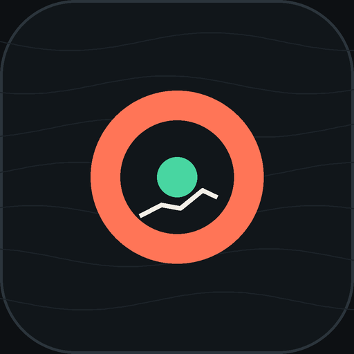
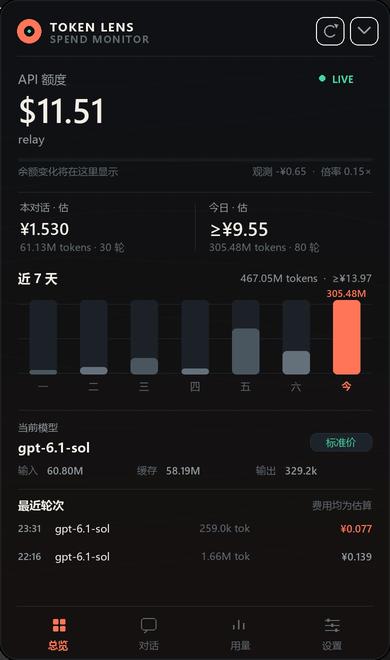
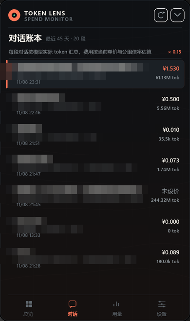
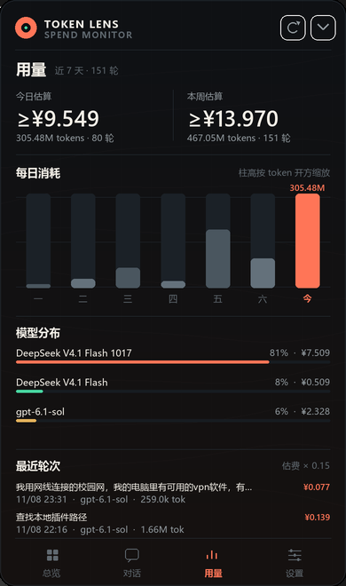
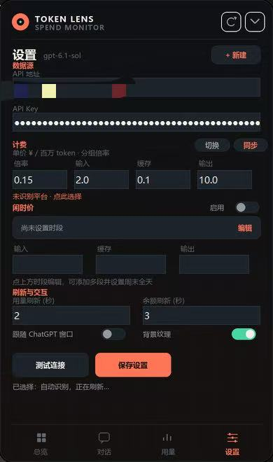

# Token Lens · 用量账本

<p>
  <a href="https://github.com/Asukazt/token-lens/releases/latest"></a>
  <a href="LICENSE"></a>
  
  
  <a href="https://github.com/Asukazt/token-lens/releases"></a>
</p>



Windows 上运行的 Codex 插件（`api-balance@local`）：余额悬浮窗、逐会话 token 账本、模型费用估算与分时计价。

## 本次源码更新（2026-11-13）

- **同一 URL 多分组独立计价**：每个分组独立保存名称、倍率、模型价格和闲时配置，可新建、复制、删除和分页切换。已关联的 API Key 通过本机指纹选择分组；同一 Key 对应多个实际分组时仍需手动切换，无法仅凭 URL 自动判断服务端分组。
- **按分组管理模型价格**：在「设置 → 计费 → 模型价格」查看当前自定义分组的已保存模型，编辑标准单价及已有闲时单价。价格按人民币／百万 token 展示，尚未乘分组倍率；列表随分组切换更新，已打开的编辑页固定原分组。
- **删除模型定价**：确认后仅移除目标分组内该模型的标准价和闲时配置，保留其他模型、分组及凭据。取消或写入失败时保留编辑内容。
- **小窗文字优化**：保持 118×30 尺寸，分组名加粗、倍率独立右对齐，长名称省略显示；未确定分组时提示选组。
- **历史估费快照**：已观察到且有可用价格的轮次保存计价快照，后续切组或改价不重算这些轮次。旧记录只能采用首次建立快照时的估算，无法据此追溯真实扣费；平台账单仍是实际费用依据。

## 界面预览

<table>
  <tr>
    <td align="center"><br><sub><b>总览</b> · 余额、近 7 天消耗、当前模型</sub></td>
    <td align="center"><br><sub><b>对话</b> · 逐会话 token 账本（标题已打码）</sub></td>
  </tr>
  <tr>
    <td align="center"><br><sub><b>用量</b> · 每日消耗、模型分布</sub></td>
    <td align="center"><br><sub><b>设置</b> · 计费倍率、闲时计价、刷新频率</sub></td>
  </tr>
</table>

以上为仓库已有的 v2.0.1 界面预览，新分组和模型价格功能以当前源码为准。

## 下载

本次更新已合入 `main` 源码，获取本次新增功能请克隆本仓库：

```powershell
git clone https://github.com/Asukazt/token-lens.git
cd token-lens
```

也可使用仓库的 **Code → Download ZIP**，解压后进入项目根目录。已有的发布包仍保留在 **Releases** 页，未包含本次源码更新：

- 已有发布版：[v2.0.1 · Token Lens 2.0.1](https://github.com/Asukazt/token-lens/releases/latest)
- 全部版本：[Releases](https://github.com/Asukazt/token-lens/releases)

## 安装

1. 将克隆或解压后的项目放到准备长期保留的目录（安装后请不要移动该目录）。
2. 双击 `install.cmd`，或在 PowerShell 中运行：

   ```powershell
   powershell.exe -NoProfile -ExecutionPolicy Bypass -File .\install.ps1
   ```

3. 重启 Codex，在设置的插件页启用 **Token Lens · 用量账本**。

安装脚本会优先查找 Codex 自带的 Python，其次使用 PATH 中的 Python；随后按你的电脑生成 `.mcp.json`，注册名为 `local` 的本地市场并安装 `api-balance@local`。生成的路径文件不受 Git 跟踪。

> 若你已经有其他名为 `local` 的本地市场，请先确认是否需要把来源切换到此目录。本包需要先运行安装脚本，不支持直接把 GitHub 地址当作已准备好的插件市场安装。

## 环境要求

- Windows
- Python 3.10+
- `tkinter`、`Pillow`（缺少 Pillow 时执行 `python -m pip install -r requirements.txt`）

## 使用

- 在对话中询问余额、用量，或打开／关闭悬浮窗。
- 悬浮窗包含总览、对话、用量和设置四个页签。
- 在设置中填写自己的 API 地址和密钥，按需配置阿里云或火山引擎账单权限。
- 支持自定义模型单价、倍率、闲时时段和周末计价；显示费用是估算值。
- 同一 API 地址的计价分组独立保存。切换或删除分组不会修改 API Key；不同站点使用各自的价格，不复用其他站点的倍率。
- 本机配置由设置页保存，也可以把 `plugins/api-balance/config.example.json` 复制为同目录下的 `config.json` 后自行填写。示例凭据均为空，不包含任何真实配置。

默认会从本机 `~/.codex/config.toml` 读取中转接口配置，并读取本机 Codex 会话日志统计 token。若希望关闭配置继承，可设置 `relay.inherit` 为 `false`，同时清空 `relay.base_url` 和 `relay.api_key`。

## 检查与卸载

```powershell
# 只生成本地启动配置并检查 Python，暂不注册到 Codex
.\install.ps1 -PrepareOnly

# 离线自检，不需要填写密钥
python -B .\check.py

# 分组、模型价格、设置及窗口行为回归测试
python -B -m unittest discover -s .\plugins\api-balance -p "test_*.py" -v

# 卸载插件
codex plugin remove api-balance@local
```

检查会使用合成数据和临时配置，不需要查询真实余额或调用计费接口。`-PrepareOnly` 仅生成本机 `.mcp.json` 并检查运行依赖，不注册插件。

## 数据与隐私

发布包使用白名单打包，**不包含** API Key、AccessKey、本地 `config.json`、Codex 配置、账单缓存、余额历史、会话日志、窗口状态、运行日志或截图。

运行时，余额查询会向你配置的 API／云厂商发送相应认证信息；价格同步会访问厂商公开价格页，节假日同步会访问 `timor.tech`。会话统计在本机计算。凭据以明文保存在本机配置文件中，请妥善保护文件权限。

`.gitignore` 会忽略本地配置及其备份、生成的 `.mcp.json`、日志、余额与用量记录、缓存、窗口状态和个人快捷方式。不要提交或分享这些文件；仅复制脱敏的 `config.example.json`，提交前仍应检查暂存文件清单与内容。

## 许可

[MIT](LICENSE)
